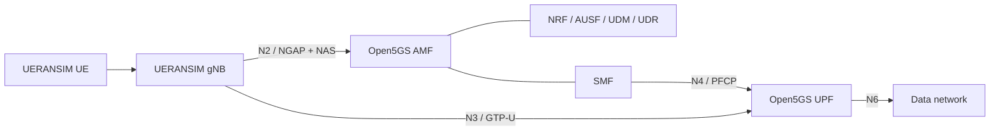

# Cloud-Native 5G Core Network — Telecom Engineering Lab

A reproducible **5G Standalone (SA) engineering study** based on Open5GS, UERANSIM, Linux containers, protocol inspection and Python-based KPI analysis.

> **Status: deployment-ready research scaffold, NOT an independently verified running 5G network.** The Open5GS/UERANSIM deployment is provided by the upstream `docker_open5gs` project, which must be reviewed and executed on a Linux host. Do not claim experimental results until you have reproduced them.

## Architecture



## What is included

- `scripts/bootstrap.sh`: fetches a community Docker Open5GS/UERANSIM lab as an **external dependency**.
- `scripts/preflight.sh`: checks host prerequisites and common Linux kernel dependencies.
- `scripts/collect_diagnostics.sh`: records Docker service state and network environment.
- `scripts/benchmark.sh`: records ping measurements to CSV (requires a working UE tunnel and reachable destination).
- `scripts/analyze_kpis.py`: summarizes measured latency, packet loss and throughput samples.
- `scripts/analyze_pcap.sh`: extracts relevant 5G protocol fields from a pcap using `tshark`.
- `config/experiment.example.json`: repeatable experiment metadata.
- `docs/`: deployment, protocol-analysis, experiment and CV guidance.
- `tests/`: automated unit tests for the analysis code.

## Quick start (Ubuntu 22.04/24.04 recommended)

```bash
sudo apt update
sudo apt install -y git curl python3 python3-venv iputils-ping iperf3 tcpdump tshark
bash scripts/preflight.sh
bash scripts/bootstrap.sh
```

**Next:** read `docs/DEPLOYMENT.md`. Upstream configuration files, container image versions and startup commands may change. Use the upstream README and compose file as the authority; do not assume this scaffold launches a 5G core by itself.

## Measure

```bash
# Replace with a real reachable test IP over the UE data path
bash scripts/benchmark.sh 1.1.1.1 10 results/ping.csv
python3 scripts/analyze_kpis.py --ping results/ping.csv --out results/summary.json
python3 -m unittest discover -s tests -v
```

**Important:** a ping from the host does not prove a 5G PDU session. Run measurements in the UE's network namespace or bind to the UE tunnel, then record the exact command and route in the experiment log.

## Research questions

1. How reliably does a simulated UE register with a containerized 5G SA core?
2. How do control-plane signaling and PDU-session establishment behave?
3. How do RTT, loss and throughput change under different test loads?
4. How do service restarts affect registration and session recovery?

## Academic integrity

Credit upstream components, disclose modifications, attach raw captures and logs, and separate simulated conditions from real radio measurements. UERANSIM is a software simulator: no real over-the-air 5G performance is measured.

## License

This original scaffold is MIT-licensed. Third-party dependencies retain their own licenses. See `LICENSE` and `THIRD_PARTY.md`.
